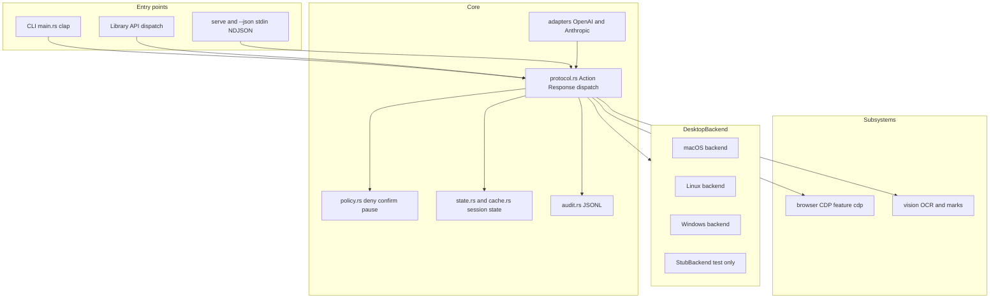

# Architecture

`computer-use` is one Rust crate that builds one CLI binary and one library. Both go through the same dispatcher, so an action behaves identically through the CLI, `exec`, `serve`, stdin, or the library API. This page describes the system structure, the request path, and the boundaries between the pieces.

## System context

## Request path

1. `src/main.rs` parses the command line with clap into an `Action` (or `exec` / `serve` / `--json` parse JSON lines). Adapters translate OpenAI `computer` and Anthropic `computer_20251124` objects into the native action before dispatch.
2. The JSON request parser separates shared context keys (`app`, `window`, `element`, `tier`, `session`, and the rest) from `Action`. The dispatcher validates the action, loads policy, resolves targets, and applies the relevant deny, pause, and confirmation guards before execution. Typed library callers pass an `Action` and optional `CallContext` directly.
3. The platform backend behind the `DesktopBackend` trait performs the action. The trait is synchronous and `Send + Sync`; a stub implementation backs unit tests.
4. The response is one JSON object: `{"ok":true,...}` or `{"ok":false,"error":{"code":"...","message":"..."}}`. The shared dispatch path catches unwinding panics inside action execution and reports `execution_failed`; this is not protection against process aborts or native crashes.
5. `src/audit.rs` appends one JSONL line for the decision and outcome. A write failure is reported but does not by itself fail the desktop action.

## Crate layout

| Area | Modules | Responsibility |
| --- | --- | --- |
| Entry | `lib.rs`, `main.rs` | Public re-exports; clap CLI and exit codes. Both deny unsafe code. |
| Protocol | `protocol.rs`, `error.rs`, `types.rs`, `attempt.rs` | `Action`/`Response`, JSON parsing, dispatch, batch, error codes, geometry types. |
| Targeting | `target.rs`, `element.rs`, `tree.rs`, `state.rs`, `menu_path.rs`, `window_groups.rs` | App and window selectors, element revalidation, numbered tree rendering and diffs, post-action state. |
| Policy and safety | `policy.rs`, `audit.rs`, `foreground.rs`, `input_session.rs` | Built-in deny list, user/admin policy, confirm classification, pause state, audit log, foreground lock, session teardown. |
| Session state | `cache.rs` | Per-session revision, tree, screenshot map, and owner records; mode `0600` on Unix. |
| Platform trait | `backend/mod.rs` | `DesktopBackend`, `WindowTarget`, shared capture/input helpers. |
| Platform backends | `backend/macos/`, `backend/linux/`, `backend/windows/` | Accessibility, capture, input, app inventory, and doctor per OS. |
| Input | `tier.rs`, `keys.rs`, `scroll.rs`, `backend/input.rs`, `backend/held.rs` | Tier selection and fallback, key parsing, scroll verification, held buttons. |
| Images | `image_util.rs`, `vision/` | Encode, scale, canvas fit, coordinate remapping; OCR and the marks overlay. |
| Browser | `browser/` | CDP attach and managed launch, snapshots with refs, navigation waits, page actions. |
| Adapters | `adapters/` | OpenAI and Anthropic schema translation. |
| Diagnostics | `doctor.rs`, `isolation.rs`, `shortcuts.rs`, `overlay.rs` | Permission report, isolation matrix, Shortcuts, agent-cursor helper. |
| Test scaffolding | `test_backend.rs` | In-memory backend, compiled into test builds only. |

## Platform backends

`DesktopBackend` is the boundary between portable logic and the operating system. Unsupported-operation defaults return `ComputerError::Unsupported`; other defaults delegate to shared implementations, including real capture and input. Tests override those paths with `StubBackend` rather than assuming defaults are inert.

- **macOS** — Accessibility through `objc2-application-services` (`AXUIElement`), ScreenCaptureKit for capture with the desktop image as a fallback, `CGEventPostToPid` for the `event` tier, `NSWorkspace` for app inventory, Vision for OCR. The private SkyLight focus path is behind the `skylight` feature; the virtual-display probe is behind `virtual-display`.
- **Windows** — `EnumWindows` and process lookups through the `windows` crate, UI Automation through `uiautomation` for the tree and element actions, `Windows.Graphics.Capture` through `windows-capture` for per-window frames, `Windows.Media.Ocr` for OCR. A missing or failing UIA pattern can fall back to `SetForegroundWindow` plus enigo under `foreground.lock` for press and type only; `--require-background` refuses that fallback.
- **Linux** — AT-SPI for the accessibility tree, XTest (`x11rb`) for the `event` tier on plain X11, and the XDG Desktop Portal (`ashpd`, `pipewire`, `reis`) behind the `portal` feature for Wayland capture and input. `xdotool` improves frontmost-window lookup when installed.

## Input tiers

`--tier` selects the input mechanism. Auto is platform-tuned; the tiers are:

| Tier | Cursor and focus | Mechanism |
| --- | --- | --- |
| `ax` | Untouched | Accessibility action or value. |
| `event` | Platform-dependent | macOS posts to a target pid; Linux uses XTest or RemoteDesktop. Do not assume Linux input leaves the cursor untouched. |
| `synthetic` | Untouched if the private call works | SkyLight front-process illusion. Requires the `skylight` feature. |
| `activate` | Foreground input | Activate the target and use foreground input. Focus restoration is platform-dependent and best-effort, not a guarantee that cursor or focus is unchanged. |

`activate` takes `<cache>/foreground.lock`; a second session that asks for it receives `execution_failed` naming the holder. `--allow-foreground` skips the lock and `--require-background` refuses the `activate` fallback. `--no-overlay` skips the agent-cursor helper. The auto plan and fallback rules are implemented in `src/tier.rs`.

## Coordinates

Click, move, scroll, and screenshot regions use logical screen points. `displays` reports logical `x`, `y`, `width`, and `height`; `scale` is physical pixels divided by logical width. A screenshot's pixel size can differ from the logical region. `image_util.rs` computes the screenshot map, and `--coord image` (or `coord: "image"`, which the adapters set automatically) remaps image pixels to screen points through the stored map.

`--display <id>` resolves one monitor from `displays` and gates every point, region, and window target against it. The filtered capture reuses the shared `backend::capture` path, so the map origin is the monitor origin. See `docs/ISOLATION.md`.

## Session state and paths

| Item | Path |
| --- | --- |
| Session cache | `${XDG_CACHE_HOME:-~/.cache}/computer-use/sessions/<session>/`; `%LOCALAPPDATA%\computer-use\cache\sessions\<session>\` on Windows. |
| Foreground lock | `<cache>/foreground.lock`. |
| Overlay socket | `<cache>/overlay.sock`. |
| User policy | `${XDG_CONFIG_HOME:-~/.config}/computer-use/policy.toml` on every OS; `--policy` overrides it. |
| Admin policy | `/etc/computer-use/policy.toml`; `%ProgramData%\computer-use\policy.toml` on Windows. |
| Audit log | `${XDG_STATE_HOME:-~/.local/state}/computer-use/audit.jsonl`; `%LOCALAPPDATA%\computer-use\audit.jsonl` on Windows. |

The default session is the current process id, so separate one-shot invocations only share element indices and screenshot maps when they pass the same `--session`. Cache files are JSON, mode `0600` on Unix, and redact recognized secure-field values. `XDG_CACHE_HOME` overrides the cache base on every OS, including Windows; `XDG_STATE_HOME` similarly overrides the audit base. `session prune` removes empty session directories and content whose owner is dead or unknown after the TTL; a live owner's content is never deleted. Unit-test builds panic on cache access without `XDG_CACHE_HOME`.

## Policy, confirm, and pause

The shared dispatcher applies policy, confirmation, secure-field checks, and the cross-process pause state before relevant actions. These safeguards and their configurable exceptions are described in [SECURITY.md](SECURITY.md#policy-and-confirmation); configuration examples live in [docs/policy.example.toml](docs/policy.example.toml). They are not an OS isolation boundary.

## Browser subsystem

`src/browser/` implements Chrome DevTools Protocol support behind the `cdp` feature. Without the feature every browser command returns `unsupported`. In attach mode the driver connects to a Chromium started with `--remote-debugging-port=N`, discovering the port from the target process; `browser launch` starts a managed Chromium with an isolated profile and records the port in the session cache. Snapshots are compact accessibility trees with stable `ref=eN` handles that are revalidated before an action, so a ref from a different document returns `stale_element`. URL navigation is checked against `[browser].blocked_urls`, and password fields are refused.

## Vision

`src/vision/` renders the set-of-marks overlay (tree indices on a window target, OCR indices when no tree is available) in platform-independent image code, and selects the OCR backend: Vision on macOS, `Windows.Media.Ocr` on Windows, `unsupported` on Linux. Both platforms return the same block shape, so callers never branch. OCR on a window redacts secure-field frames.

## Isolation

`isolation` is a pure report of what the build can isolate. `--display <id>` is a real capture and coordinate filter; `--display virtual` prints the Xvfb recipe and, with `--exec`, runs a command with `DISPLAY` set; the macOS `CGVirtualDisplay` probe is experimental and never creates a display. There is no hypervisor dependency and no hidden sandbox. `docs/ISOLATION.md` is the source of truth.

## Cross-cutting decisions

- **One binary, no server.** `serve` and `--json` are stdin/stdout protocols. There is no TCP listener, no MCP server, and no daemon.
- **Stable error codes.** `ComputerError::code()` is the JSON contract; codes are documented in `README.md` and `docs/CLI.md`.
- **Strict action decoding.** `Action` uses `deny_unknown_fields` to reject typos on data-bearing variants after shared context is extracted. Do not infer that every nested type or unit variant rejects extra fields.
- **Honest off-platform behavior.** Commands exist everywhere and return `unsupported` when the backend cannot run them.
- **Unsafe code is contained.** Crate roots deny it; platform FFI and a few test helpers have local exceptions. Safety requirements are documented at each unsafe operation.
- **Features compile everywhere.** `cdp`, `skylight`, and `virtual-display` compile on all three targets; `portal` is Linux-gated so `--all-features` still builds on macOS and Windows.
